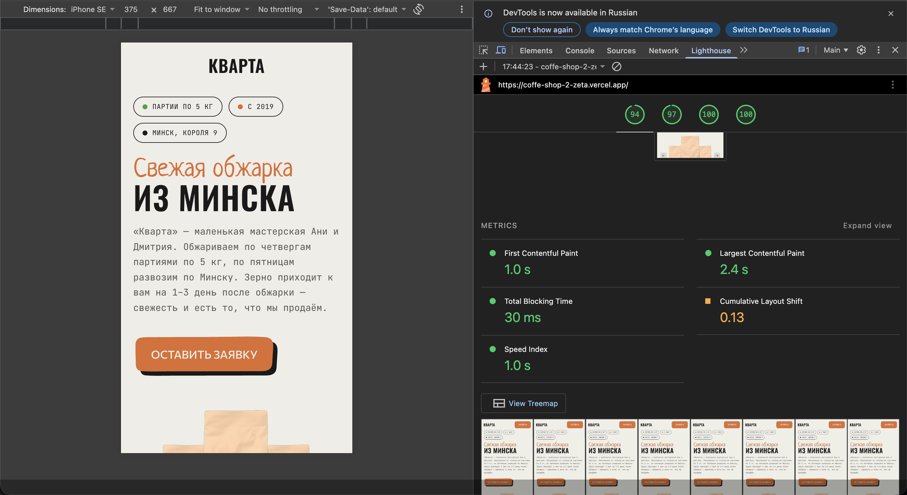

(https://coffe-shop-2-zeta.vercel.app/)[https://coffe-shop-2-zeta.vercel.app/]

Запуск для разработки: `npm run dev`
Запуск для прода: `npm start`

- cтек проекта: next, tailwind, zod
- Для определения с какой рекламы пришел пользователь, в будущем можно подключить Яндекс-метрику
- Валидация контактной формы - html валидация, валидация на бекенде
- Заявки отправляются через tg-бота, настройки задаются в .env, пример .env лежит в .env.example, сохранять в sqlite часто смысла нет, потому что у nextjs часто хостинг эфемерный(не сохраняются изменения в файловой системе при перезапуске), помимо tg-бота можно просто сделать сохранение в google sheets
- Сделаны og-мета-теги, превью генерируется на фронте с картинкой coffee-bag-blank-hq.png
- Использованная картинка coffee-bag-blank-hq.png - сгенерированная, в будущем я бы попросил настоящие фотографии пакетов с кофе у заказчиков

---

**Lighthouse**

Не успел добавить блок с фотографиями, футер

Руками делал только маленькие правки стилей, всё остальное — ИИ

**Где ИИ ошибся**

- Форма: ИИ поставил `noValidate` и не сделал валидацию телефона — заметил при отправке, попросил переделать
- Кнопка в шапке: базовые стили `.flat-button` без `@layer`, из-за этого нельзя было переопределить display через Tailwind — кнопка не пряталась на узком экране, попросил обернуть стили кнопок в `@layer component`
